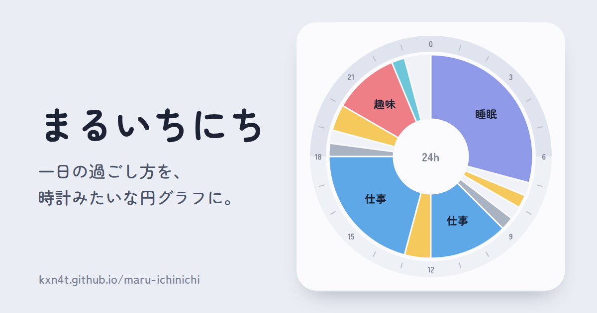

# まるいちにち

https://kxn4t.github.io/maru-ichinichi/

一日の過ごし方を、時計みたいな円グラフにして画像で共有できるWebツールです。

- 予定の追加・編集（円の空きをタップして追加、境目のドラッグで15分刻みに調整、扇形やリストのドラッグで並べ替え）
- 画像の保存・クリップボードへのコピー
- 予定をリンクに埋め込んで共有（`#d=…`。データはURLのフラグメントに入るため、サーバーには送られません）

`index.html` 1ファイルで動作します。入力内容はブラウザの localStorage に保存されます。

## ライセンス

[MIT License](LICENSE)
